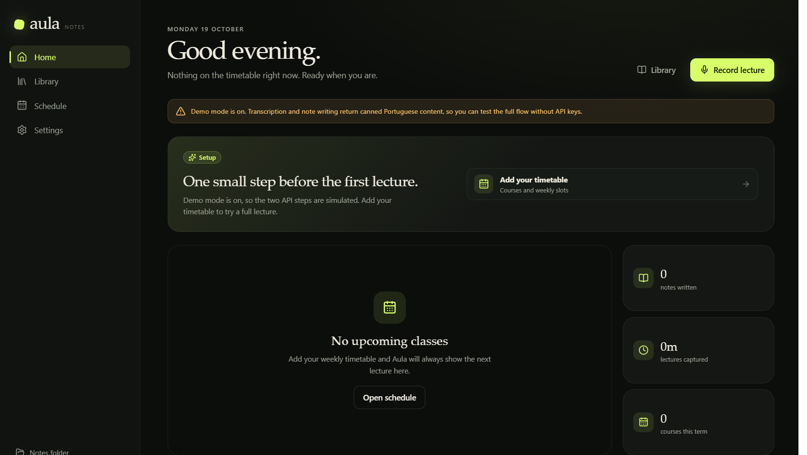

# Aula

A Windows desktop app that listens to lectures, transcribes them in European
Portuguese, throws away the filler, and writes structured Markdown notes.



It is built for the case where you want notes, not a recording archive:

- **Live view** — running transcript and a rough outline while the lecture happens.
- **After class** — a second, more accurate transcription pass and an LLM pass that
  extracts concepts, definitions, examples, exam hints, questions, and a glossary.
- **Your files** — one Markdown note per lecture, organised by course and date.
- **Local first** — audio, transcripts, notes, and keys stay on the PC, apart from
  the explicit Groq/OpenCode requests.

## Status

Working MVP, tested end-to-end in demo mode and against local mock Groq/OpenCode
endpoints on Windows. Real Groq and OpenCode calls are implemented but need your keys.

## Requirements

- Windows 10/11
- Node.js 20+ (developed on Node 24)
- A microphone
- Internet access for Groq transcription and OpenCode note writing

## Run it

```powershell
cd C:\Users\rafal\Desktop\projects\aula
npm install
npm run dev
```

On first launch:

1. Open **Schedule** and add your courses and weekly class slots.
2. Open **Settings** and paste a Groq API key and an OpenCode API key.
3. Press **Record lecture** on the dashboard.

### Demo mode

To try the whole flow without any API keys or API spend:

```powershell
$env:AULA_MOCK_AI="1"
npm run dev
```

Demo mode returns canned Portuguese transcript lines and a canned structured note.
It exercises recording, WAV writing, the live view, the retention dialog, Markdown
output, the library, and note rendering.

## API keys

Keys are stored in the app's user-data folder, encrypted with Windows DPAPI via
Electron `safeStorage`. They are never written to the notes folder or the repo.

### Groq (speech-to-text)

Create a key at <https://console.groq.com/keys>. The app uses
`whisper-large-v3-turbo` by default, with `whisper-large-v3` as an option.

### OpenCode (notes)

The app calls an OpenAI-compatible `/chat/completions` endpoint. The default is
**OpenCode Go**:

```text
https://opencode.ai/inference/go/openai/v1
deepseek-v4.1-flash
```

OpenCode's docs describe Go as intended for coding-agent traffic, so for a general
app the **OpenCode Console** provider is the safer choice:

```text
https://opencode.ai/inference/openai/v1
```

You can also choose **Custom OpenAI-compatible** and point it at any provider.

## How the pipeline works

```text
Microphone
  → AudioWorklet (16 kHz mono PCM)
  → WAV on disk
  → Groq Whisper (live chunks + final full pass)
  → timestamped transcript
  → OpenCode model
  → importance filter + structured Markdown
  → Documents\Aula\<Course>\<date> <title>.md
```

- Live transcription sends 7.5-second chunks every 5 seconds and removes overlapping
  words. Expect roughly 3–6 seconds of lag.
- The final pass re-transcribes the full audio, so it is more accurate than the live text.
- The prompt instructs the model to omit logistics, chatter, and repetition, and to keep
  definitions, formulas, examples, and lecturer emphasis.
- Audio retention is a choice after every class. Kept audio is deleted after 30 days
  (configurable), while transcripts and notes remain.

## Files and folders

- Notes: `Documents\Aula\<Course>\`
- Transcripts: `Documents\Aula\.aula\transcripts\`
- Audio: `%APPDATA%\aula\recordings\<recording-id>\audio.wav`
- Settings/schedule/encrypted keys: `%APPDATA%\aula\`

## Troubleshooting

- **A note is empty or incomplete** — open it and click **Regenerate**. Aula keeps the
  transcript even when the audio is deleted, and it now retries the model with a larger
  output budget and a compact prompt. If the model still fails, a transcript-only note is
  saved instead of an empty file.
- **Transcription or notes fail** — the audio and transcript stay on disk. Check the keys
  in Settings, then retry from the recording or regenerate the note.
- **Logs** — `%APPDATA%\aula\aula.log` contains model/finish-reason diagnostics, without
  API keys or full transcripts.

## Packaging

```powershell
npm run pack   # unpacked app in release\win-unpacked
npm run dist   # NSIS installer in release\
```

The generated executable is unsigned. Windows SmartScreen or an Application Control
policy may block it. For personal use, run from source with `npm run dev`, or sign the
binary with a trusted code-signing certificate before distributing it.

## Privacy and consent

- Audio is sent to Groq for transcription.
- The transcript is sent to the chosen OpenCode/OpenAI-compatible endpoint for notes.
- No analytics or telemetry is built into Aula.
- Recording a lecture may require consent. Inform the lecturer and follow your
  institution's rules. The live screen always shows a recording indicator.

## Project layout

```text
src/
  main/        Electron main process, recording, STT, LLM, notes, storage
  preload/     Typed IPC bridge
  renderer/    React UI (dashboard, live, library, note, schedule, settings)
  shared/      Types shared by main and renderer
scripts/       Local CDP inspection helpers used during development
```

## Known limits / next steps

- No speaker diarization (lecturer vs students).
- No automatic recording at class time; it shows the next class and asks you to start.
- Audio is WAV; a future version could compress it to Opus to save disk.
- No tray icon or global recording hotkey yet.
- No crash recovery if the app is killed mid-recording; the WAV may be left with an
  unfinalized header.
- Live outline updates every ~90 seconds to keep token use low.
- GPT, Claude, Gemini, and Qwen models use different API shapes from Chat Completions;
  the MVP supports Chat Completions models only (DeepSeek, GLM, Kimi, and similar).
